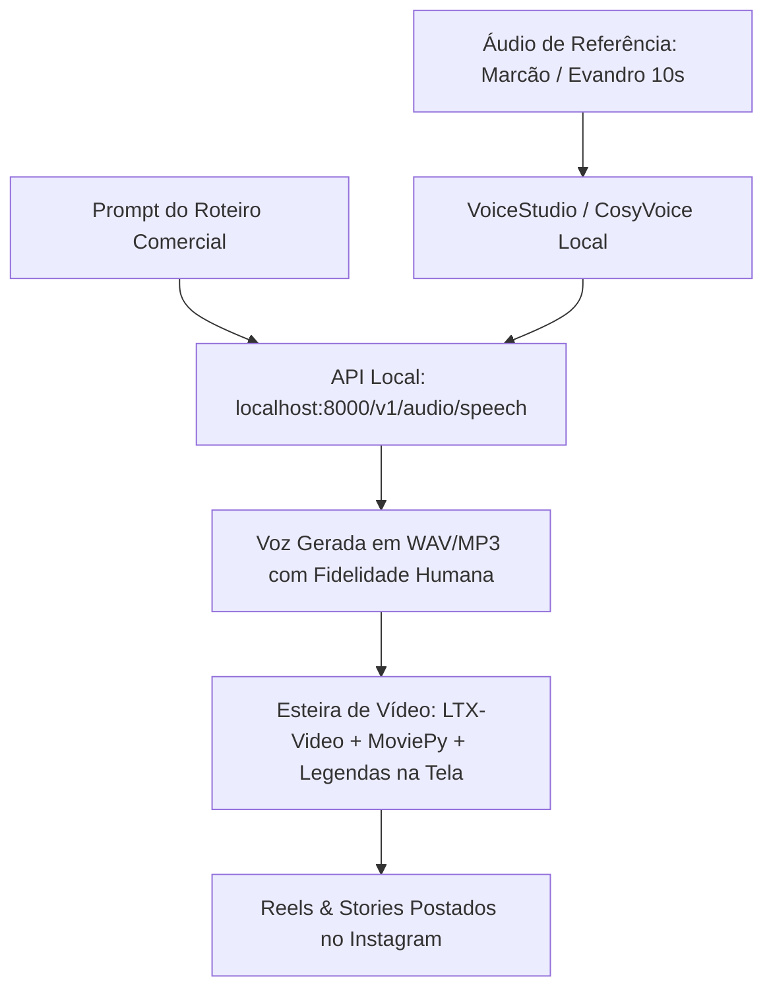

# Arquitetura de Clonagem de Voz Open-Source — VoiceStudio & Motores SOTA

Este documento consolida o mapeamento do ecossistema open-source de síntese e clonagem de voz humana ultra-realista para abastecer a esteira autônoma de vídeos, Reels, Stories e atendimentos do Marcão Personal com custo zero e tokens ilimitados.

---

## 1. O Projeto Identificado: VoiceStudio

- **Repositório GitHub:** [https://github.com/debpalash/VoiceStudio](https://github.com/debpalash/VoiceStudio) (78.200+ Stars)
- **Criador:** Debashis Pal (@debpalash)
- **Site Oficial & Documentação:** [https://voicestudio.sh](https://voicestudio.sh)
- **Natureza do Projeto:** Engenharia reversa completa da plataforma ElevenLabs realizada por um desenvolvedor independente com auxílio de modelos de IA.
- **Diferencial Crítico:** Roda 100% offline e local na própria máquina, sem mensalidade, sem limite de caracteres/créditos e sem envio de dados para servidores externos.

---

## 2. Motores Integrados (Os 14 Motores de Voz)

O VoiceStudio unifica 14 motores de IA de áudio em uma única interface visual e API unificada:

1. **CosyVoice 3 (Alibaba FunAudioLLM):** Considerado o estado da arte (SOTA) atual para clonagem *zero-shot* multilíngue com alta carga emocional, controle de respiração, risadas e prosódia humana imperceptível.
2. **GPT-SoVITS:** Campeão mundial de fidelidade em poucas amostras. Clona perfeitamente o timbre e os harmônicos de uma voz com apenas 5 segundos de áudio de referência.
3. **OmniVoice (k2-fsa / Next-gen Kaldi):** Motor padrão do VoiceStudio, ultra-estável, com suporte a dezenas de idiomas e dialetos.
4. **IndexTTS 2.5:** Otimizado para long-form speech (audiolivros, podcasts e vídeos longos com narração fluida).
5. **Sherpa-ONNX:** Motor ultra-rápido compilado para inferência em CPU (não exige GPU dedicada e roda em microssegundos).
6. **dots.tts & MOSS-TTS-v1.5:** Modelos modernos de alta fidelidade e baixa latência.
7. **KittenTTS, pockettts, supertonic3 & VoxCPM2:** Motores ultra-leves e eficientes para dispositivos com pouca VRAM ou uso em tempo real.
8. **Confucius4-TTS & MLX-Audio:** Suporte otimizado multiplataforma.

---

## 3. Principais Recursos Nativos

- **Clonagem Instantânea de Voz (Voice Cloning):** Envie de 5 a 15 segundos de um áudio limpo (sem música de fundo). O sistema extrai o *speaker embedding* e clona a entonação, o sotaque e as características tímbricas.
- **Design de Novas Vozes por Texto (Voice Design):** Geração de novas personas a partir de prompts descritivos (ex: *"Homem atlético brasileiro, 38 anos, tom enérgico de personal trainer, voz firme e confiante"*).
- **Dublagem Automática de Vídeo (Video Dubbing):** Sincronização automática de áudio com o tempo exato das falas em 646 idiomas.
- **Isolamento Vocal & Diarização:** Separação de voz de ruídos de fundo e identificação de múltiplos oradores no mesmo arquivo.
- **API Local Compatível com OpenAI:** Expõe um servidor HTTP local (`http://localhost:8000/v1/audio/speech`) e suporte nativo ao protocolo MCP (Model Context Protocol).

---

## 4. Modelos Open-Source Individuais de Destaque

Além do VoiceStudio como suíte, os dois modelos individuais mais impressionantes da comunidade atual são:

1. **F5-TTS (`SWivid/F5-TTS`):**
   - Baseado em *Flow Matching* não-autoregressivo.
   - Consegue reproduzir com naturalidade assombrosa micro-pausas, sussurros, empolgação e cadência humana real com apenas 3 a 10 segundos de áudio.
2. **Kokoro-82M (`hexgrad/Kokoro-82M`):**
   - Com apenas 82 milhões de parâmetros, roda de forma instantânea em CPU comum.
   - Qualidade comparável a locutores profissionais de rádio e estúdio comercial.

---

## 5. Como Integrar na Esteira do Marcão Personal



### Passo a Passo de Execução:
1. **Instalação no Windows:**
   - Via PowerShell:
     ```powershell
     irm https://voicestudio.sh/install | iex
     ```
   - Ou via instalador oficial (.exe) no GitHub Releases:
     `https://github.com/debpalash/VoiceStudio/releases/latest`
2. **Clonar a Voz do Marcão:**
   - Carregar o arquivo `apps/api/output/marcao_pilot_voice.mp3` ou a matriz de voz de Evandro.
   - Salvar a persona clonada com o ID `marcao_personal`.
3. **Substituição da Chamada de Áudio nos Scripts:**
   - Nos scripts Python (`daily_reel_generator.py` e geradores de áudio), apontar a chamada de TTS para o endpoint local (`http://localhost:8000/v1/audio/speech`), eliminando custos de tokens de terceiros.
