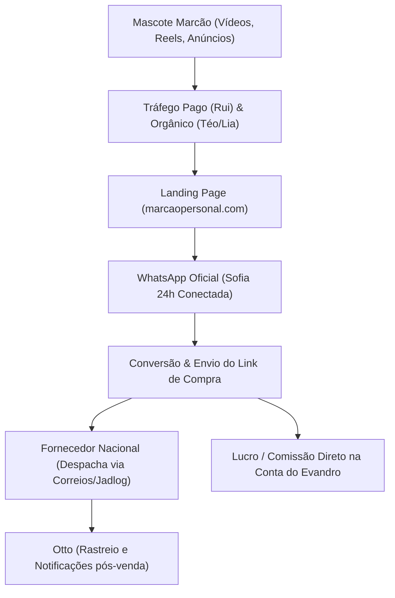

# ESTUDO ESTRATÉGICO DE PRODUTOS & FORNECEDORES SEM ESTOQUE
**Empresa:** Marcão Personal  
**Diretor Responsável:** Evandro da Silva Gallina  
**Nicho:** Beleza Estética Corporal, Queda Capilar (Tecnologia LED + Nutracêuticos), Pele Firme e Definição Muscular  

---

## 1. Visão Geral: Como Operar 100% Sem Estoque no Brasil

Para a marca **"Marcão Personal"** vender suplementos e aparelhos de estética sem investir um único centavo em estoque inicial ou galpão, existem **3 modelos consolidados** no mercado brasileiro:

| Modelo | Onde Encontrar | Como Funciona | Margem / Lucro | Logística / Envio | Complexidade |
| :--- | :--- | :--- | :--- | :--- | :--- |
| **1. Afiliado de Físicos / Encapsulados Validados** | **Braip**, **Monetizze**, **Appmax** | Você promove produtos físicos de alta conversão. A fábrica cuida da produção, embalagem, emissão de NF e Correios. | **40% a 70%** (R$ 80 a R$ 140 por frasco/kit) | Feita 100% pelo produtor | **Imediata (Zero Barreira)** |
| **2. Dropshipping Nacional de Gadgets & Estética** | **Dropi** (conectado a armazéns de SP / AliExpress BR / Shopee) | Você lista os aparelhos (como a **Escova de LED Capilar**) na sua loja. Quando vende, o Dropi envia o pedido ao fornecedor em SP que despacha ao cliente. | **60% a 75%** (Custo R$ 45 / Venda R$ 147) | Despacho nacional em 24h a 48h com rastreio | **Muito Fácil** |
| **3. White Label / Marca Própria sob Demanda** | **Capsexpress**, **Deprol**, **Medvale** | A fábrica coloca o rótulo com a sua marca "Marcão Personal" em fórmulas aprovadas pela ANVISA. | **70% a 80%** | Despacho direto ou lote mínimo inicial | **Média** (Ideal para Fase P3/P4) |

---

## 2. Análise dos Produtos Selecionados por Evandro

### 🟢 PRODUTO 1: A "Escova de LED" para Queda de Cabelo (Masculina e Feminina)
- **O que é o Produto:**
  - **Escova Massageadora com Fototerapia LED (Luz Vermelha 625nm + Luz Azul 470nm, Microvibração e Reservatório para Tônico/Óleo Capilar)**.
- **Por que converte tanto (O "Poder Oculto"):**
  - **Altíssimo apelo visual:** Criativos no TikTok e Instagram mostrando a luz vermelha penetrando no couro cabeludo e o vapor/massagem geram curiosidade imediata (efeito "UAU").
  - **Mecanismo Científico:**
    - *LED Vermelho (625nm):* Estimula a microcirculação sanguínea nos folículos, acordando fios adormecidos.
    - *LED Azul (470nm):* Ação antibacteriana e antifúngica, combate caspa e oleosidade excessiva.
    - *Microvibração sônica:* Massageia e abre os poros para absorção de nutrientes.
- **Economia do Produto:**
  - **Custo no fornecedor nacional (Dropi / Armazém SP):** R$ 38,00 a R$ 52,00.
  - **Preço de venda na Loja Marcão Personal:** R$ 127,90 a R$ 167,90.
  - **Lucro Líquido Estimado:** R$ 75,00 a R$ 115,00 por unidade vendida.

---

### 🟢 PRODUTO 2: Nutracêutico Antiqueda & Fortalecimento Capilar
- **O que é:**
  - Cápsulas ricas em **Biotina, Silício Orgânico Inteligente, Zinco e Vitaminas do Complexo B**.
- **Onde obter sem estoque:**
  - **Braip / Monetizze** (como produto físico homologado na ANVISA).
- **A Estratégia do "Combo Capilar Marcão":**
  - O cliente raramente compra só um produto se você apresentar a solução completa:
    > *"O LED do Marcão acorda o folículo por fora; as cápsulas alimentam a raiz por dentro."*
  - **Ticket do Combo (Escova LED + Pote Capilar 60 dias):** R$ 197,00 a R$ 247,00.
  - **Comissão/Lucro do Combo:** Mais de R$ 120,00 por pedido!

---

### 🟢 PRODUTO 3: Nutracêutico de Firmeza da Pele & Estética Corporal
- **O que é:**
  - **Colágeno Hidrolisado Verisol® + Ácido Hialurônico + Vitamina C + Coenzima Q10**.
- **Público:**
  - Mulheres de 25 a 55 anos que querem eliminar flacidez no bumbum, pernas, abdômen e suavizar linhas de expressão no rosto.
- **Onde obter:**
  - **Braip / Monetizze** (produtos com comprovação ANVISA e taxa de aprovação >95%).
- **Comissão:** R$ 85,00 a R$ 130,00 por frasco/kit.

---

### 🟢 PRODUTO 4: Definição Muscular & Tônus (Creatina Pura + Termogênico Drenante)
- **O que é:**
  - **Creatina Monohidratada 100% Pura** (energia celular, hidratação muscular, firmeza sem inchaço) + **TermoFit Drenante Natural** (acelera queima de gordura e reduz retenção líquida).
- **Público:**
  - Pessoas que querem emagrecer com aparência tonificada e atlética.
- **Onde obter:**
  - Dropshipping Nacional ou Afiliação direta.
- **Comissão / Margem:** 50% a 60%.

---

## 3. O Ecossistema Operacional da "Marcão Personal"

### Funções da Equipe de Agentes 24h:
1. **Mascote Marcão:** Personagem 3D / avatar carismático que estrela os vídeos e criativos educativos ("O Personal que não te deixa gastar dinheiro com bobagem").
2. **Téo & Lia (Marketing):** Geram os roteiros, ganchos visuais e textos persuasivos para TikTok, Reels e Meta Ads.
3. **Rui (Gestor de Tráfego):** Cria as campanhas pausadas no gerenciador para o Evandro aprovar com 1 clique no Painel Admin (`admin.marcaopersonal.com`), respeitando o teto de R$ 16,50/dia.
4. **Sofia (Atendimento & Vendas no WhatsApp):** Conectada na Evolution API (`open`), recebe quem clica no anúncio, responde dúvidas, indica o kit ideal e passa o link de pagamento.
5. **Otto (Processos & Logística):** Monitora códigos de rastreio, avisa o cliente sobre o status de entrega e faz o pós-venda.

---

## 4. Plano Recomendado para a Fase P1

1. **Cadastrar nas Plataformas Chave (Sem Custo):**
   - **Braip & Monetizze:** Cadastro gratuito como afiliado para ter acesso imediato às ofertas físicas de Cabelo, Colágeno e Emagrecimento.
   - **Dropi (com Yampi ou Shopify/Nuvemshop):** Para conectar o fornecedor nacional da **Escova de LED Capilar**.
2. **Construir a Landing Page no domínio `marcaopersonal.com`:**
   - Apresentando os **3 Protocolos do Marcão**:
     - *Protocolo 1: Resgate Capilar (Escova LED + Tônico/Biotina)*
     - *Protocolo 2: Pele Firme & Sem Flacidez (Colágeno Verisol + Hialurônico)*
     - *Protocolo 3: Tônus & Definição (Creatina Pura + Drenante)*
3. **Ativar a Sofia no WhatsApp:**
   - O fluxo `F3` no n8n recebe o lead vindo da Landing Page e conduz a conversa humanizada até o fechamento.
